<p align="center">
  
</p>

<p align="center">
  <a href="https://www.linkedin.com/in/benjamin-cruz-manuel-02443a14b"></a>
  <a href="https://x.com/beenjii14"></a>
  <a href="https://beenjii14.github.io/sprout/"></a>
</p>

<p align="center">
  <b>Clean architecture</b> · <b>developer experience</b> · <b>automating the boring parts</b><br>
  Lately I turn my own daily annoyances into small open source tools. 🌱
</p>

<br>

## 🌱 Featured project: sprout

<p align="center">
  <a href="https://beenjii14.github.io/sprout/"></a>
</p>

**Git branches from Jira tickets, in one command.** It reads the ticket, shortens the title with the AI CLI you already
have (Claude, Gemini, Codex, Copilot, Cursor or any command) and creates the branch.

<p align="center">
  <a href="https://github.com/beenjii14/sprout/releases"></a>
  <a href="https://github.com/beenjii14/sprout/stargazers"></a>
  <a href="https://github.com/beenjii14/sprout/blob/main/LICENSE"></a>
  <a href="https://github.com/beenjii14/sprout/actions"></a>
</p>

```sh
brew tap beenjii14/tap && brew trust beenjii14/tap && brew install sprout
```

<p align="center">
  <a href="https://beenjii14.github.io/sprout/">🌐 Website</a> &nbsp;·&nbsp;
  <a href="https://github.com/beenjii14/sprout#readme">📖 Docs</a> &nbsp;·&nbsp;
  <a href="https://github.com/beenjii14/sprout/issues">🐛 Issues</a> &nbsp;·&nbsp;
  <a href="https://github.com/beenjii14/sprout/blob/main/CONTRIBUTING.md">🤝 Contribute</a>
</p>

<br>

## 🧭 Explore

<details open>
<summary><b>🧰 Tech I work with</b></summary>

<br>

**Frontend** &nbsp;


**Backend** &nbsp;


**Data** &nbsp;


**Cloud & tooling** &nbsp;


</details>

<details>
<summary><b>📦 More from my workbench</b></summary>

<br>

| Project | What it is |
| --- | --- |
| [**homebrew-tap**](https://github.com/beenjii14/homebrew-tap) | Homebrew tap for my tools: `brew install beenjii14/tap/sprout` |
| [**nodejs-service-template**](https://github.com/beenjii14/nodejs-service-template) | Scaffold for a basic Node.js service |
| [**vite-front-template**](https://github.com/beenjii14/vite-front-template) | React + TypeScript + Tailwind starter on Vite |
| [**nextjs-template**](https://github.com/beenjii14/nextjs-template) | Next.js project with sensible defaults |
| [**code-solid**](https://github.com/beenjii14/code-solid) | Notes on clean code and SOLID principles |

</details>

<details>
<summary><b>💬 Let's talk</b></summary>

<br>

I am happy to chat about developer tooling, backend architecture and open source. If something in
[sprout](https://github.com/beenjii14/sprout) can be better, issues and pull requests are very welcome.

[LinkedIn](https://www.linkedin.com/in/benjamin-cruz-manuel-02443a14b) · [X](https://x.com/beenjii14)

</details>

<br>

<p align="center">
  <picture>
    <source media="(prefers-color-scheme: dark)" srcset="https://raw.githubusercontent.com/beenjii14/beenjii14/output/github-contribution-grid-snake-dark.svg">
    
  </picture>
</p>

<p align="center"><sub>🌱 Built with care, one small tool at a time.</sub></p>
